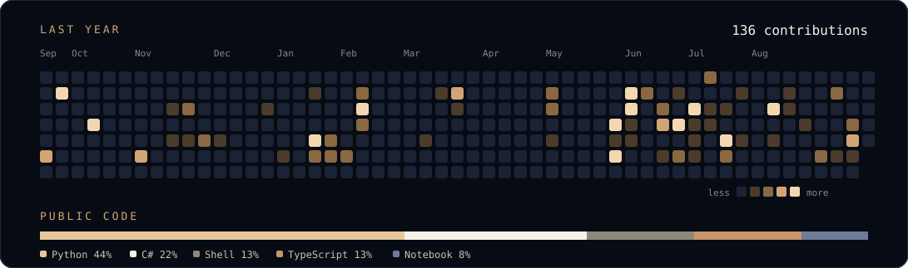
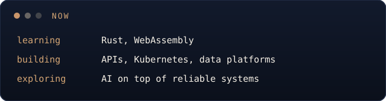

  

  

I like the layer under the product: clusters that stay up, contracts that stay honest, and data that can be trusted later. Based in Bangalore, working across infrastructure, platform engineering, the web, and AI.

<table>
  <tr>
    <td width="33%" valign="top">
      <h3>Platforms</h3>
      Kubernetes workloads, Helm, and the glue that makes a service boring to operate.
    </td>
    <td width="33%" valign="top">
      <h3>Interfaces</h3>
      Contract-first APIs. OpenAPI you can actually run, not a diagram that drifted last quarter.
    </td>
    <td width="33%" valign="top">
      <h3>Data</h3>
      Lakehouse pipelines with PySpark, Delta Lake, and object storage that behaves like a system.
    </td>
  </tr>
</table>

## Selected work

<table>
  <tr>
    <td width="72" valign="top"><strong>01</strong></td>
    <td valign="top">
      <a href="https://github.com/kbm-bax/neo-cqi-api-design"><strong>neo-cqi-api-design</strong></a> 
      OpenAPI contracts for a clinical quality platform: compliance, limits, dose rate, device and syringe usage, alerts, and data quality. Swagger UI is wired so the specs can be clicked through locally.
    </td>
  </tr>
  <tr>
    <td valign="top"><strong>02</strong></td>
    <td valign="top">
      <a href="https://github.com/kbm-bax/stateful-set-demo"><strong>stateful-set-demo</strong></a> 
      A Kubernetes StatefulSet of RabbitMQ subscribers, one queue per pod. Ships with Helm, raw manifests, a .NET 8 subscriber, and a Python queue initializer.
    </td>
  </tr>
  <tr>
    <td valign="top"><strong>03</strong></td>
    <td valign="top">
      <a href="https://github.com/kbm-bax/tutorial"><strong>Delta lakehouse tutorial</strong></a> 
      A short, runnable tour of PySpark, Delta Lake, MinIO, Jupyter, and Dremio. <code>docker compose up</code> and the stack is there.
    </td>
  </tr>
</table>

## Toolkit

  

Also in the repos: RabbitMQ, OpenAPI, PySpark, Delta Lake, MinIO, and Jupyter.

## On GitHub

A year of public commits, and the languages those repositories are written in.

## Now

---

  <a href="https://github.com/kbm-bax?tab=repositories">Repositories</a>
  &nbsp;·&nbsp;
  <a href="https://github.com/kbm-bax">github.com/kbm-bax</a>

